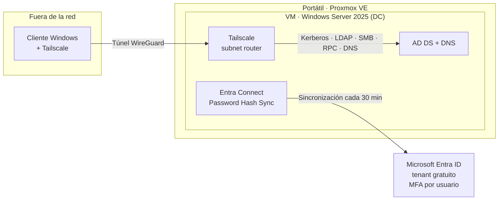

# Laboratorio de identidad híbrida

Active Directory local sincronizado con Microsoft Entra ID, MFA obligatorio y
unión al dominio desde fuera de la red mediante Tailscale. Montado a coste cero
sobre un portátil doméstico.

!!! info "Contexto"
    Laboratorio personal montado entre abril y mayo de 2026 para practicar la
    arquitectura de identidad que uso a diario con clientes. Los nombres de
    dominio, tenant, equipos y usuarios, y las direcciones de Tailscale, se han
    omitido.

---

## Objetivo

Reproducir el escenario de identidad más habitual en la empresa mediana: un
directorio local como fuente de verdad, sincronizado con Entra ID, con MFA
obligatorio en la nube y equipos que se unen al dominio aunque no estén en la
oficina. Todo sin coste, que resultó ser parte del reto.

---

## Arquitectura



| Capa | Tecnología |
|---|---|
| Virtualización | Proxmox VE en un portátil (Intel i5 de 12.ª gen, 16 GB de RAM) |
| Controlador de dominio | VM con Windows Server 2025, AD DS y DNS |
| Sincronización | Microsoft Entra Connect Sync con Password Hash Sync |
| Identidad en la nube | Microsoft Entra ID, tenant gratuito |
| Acceso remoto | Tailscale, VPN mesh sobre WireGuard |
| Cliente | VM con Windows, unida al dominio desde fuera de la red |

---

## Active Directory

Windows Server 2025 promovido a controlador de un dominio nuevo. Los usuarios de
prueba se crean con contraseña inicial y cambio obligatorio en el primer inicio
de sesión. La política de contraseñas se aplica por GPO de dominio: longitud
mínima de 12 caracteres, complejidad y un historial de 24 contraseñas.

## Sincronización con Entra ID

Entra Connect Sync instalado en el propio controlador de dominio, con Password
Hash Sync por resiliencia: el inicio de sesión en la nube no depende de que el
DC local esté disponible. El ciclo de sincronización es el de por defecto, cada
30 minutos. Para no esperar:

```powershell
# Sincronización delta: solo los cambios desde la última
Start-ADSyncSyncCycle -PolicyType Delta

# Sincronización completa
Start-ADSyncSyncCycle -PolicyType Initial
```

Tras la sincronización, los usuarios aparecen en Entra ID marcados como
sincronizados desde el entorno local. El AD sigue siendo la fuente de verdad:
los cambios se hacen allí, no en la nube.

## MFA obligatorio

!!! warning "Acceso condicional sin licencia"
    El acceso condicional requiere Microsoft Entra ID P1, que el tenant gratuito
    no incluye. En el laboratorio, el MFA se fuerza **por usuario** (estado
    *enforced*) en todos los usuarios sincronizados, con Microsoft Authenticator
    habilitado en la directiva de métodos de autenticación.

El diseño de referencia era la política que se usaría en producción con P1, y el
MFA por usuario sirvió para reproducir su efecto:

| Parámetro | Valor |
|---|---|
| Usuarios | Todos los usuarios sincronizados |
| Aplicaciones | Todas las aplicaciones en la nube |
| Ubicación | Cualquiera |
| Control | Requerir autenticación multifactor |

El MFA por usuario es el método heredado y Microsoft recomienda sustituirlo por
acceso condicional. Aquí cumple su función, pero con P1 sería lo primero que
migraría.

## Unión al dominio desde fuera de la red

Tailscale crea una VPN mesh sobre WireGuard sin abrir puertos en el router, y es
gratuito hasta 100 dispositivos. El controlador de dominio actúa como *subnet
router*: anuncia la red local para que los clientes remotos puedan alcanzarla.

=== "En el DC"

    ```powershell
    tailscale up --advertise-routes=192.168.1.0/24 --accept-dns=false
    tailscale status
    ```

=== "En la consola de Tailscale"

    Aprobar la ruta anunciada por el DC en la configuración de rutas de esa
    máquina. Hasta que se aprueba, la ruta está anunciada pero nadie la usa.

=== "En el cliente"

    ```powershell
    tailscale up --accept-routes
    Add-Computer -DomainName "lab.local" -Credential (Get-Credential) -Restart
    ```

Con el túnel levantado, la unión se hace igual que en la oficina, también desde
la interfaz gráfica. Kerberos, LDAP, SMB, RPC y DNS viajan por el túnel sin
mapear ningún puerto.

---

## Con qué me peleé

**Unir un equipo al dominio a través de la VPN.** No sabía que Tailscale permite
anunciar redes completas, y sin eso el cliente no llega. Aunque el DC tenga su
propia IP del tailnet, el DNS del dominio devuelve su IP de LAN, y es esa la que
el cliente intenta alcanzar para Kerberos y LDAP. La pieza que faltaba eran las
rutas de subred, que tienen tres partes y fallan si falta cualquiera: anunciarla
en el DC, aprobarla en la consola y aceptarla en el cliente.

**Hacerlo a coste cero.** La otra parte fue de licencias: averiguar qué incluye
cada nivel. Entra Connect y el MFA por usuario entran en el tenant gratuito; el
acceso condicional no. Tailscale y Proxmox, gratis. La lección se traslada
directamente a consultoría: antes de diseñar, mirar qué licencia tiene el
cliente, porque cambia la solución.

---

## Qué cambiaría en producción

Atajos aceptables en un laboratorio que no repetiría con un cliente:

- **Entra Connect en un servidor dedicado.** Microsoft lo soporta en un DC, pero
  el servidor de sincronización es un activo Tier 0 y conviene aislarlo.
- **Sufijo UPN enrutable.** Con un dominio `.local`, los usuarios llegan a Entra
  con el sufijo `onmicrosoft.com`. Lo correcto es añadir un sufijo UPN de un
  dominio verificado antes de sincronizar.
- **Acceso condicional en lugar de MFA por usuario**, y bloqueo de la
  autenticación heredada.
- **Rutas de Tailscale mínimas.** Anunciar solo la IP del DC en lugar de toda la
  /24 y limitar el acceso con ACLs del tailnet. Y desactivar la expiración de
  clave en el DC, para que el túnel no se corte cuando caduque.

---

## Siguientes pasos

- Integrar Zscaler para cerrar el modelo Zero Trust sobre la misma identidad.
- Desplegar AD DS en Azure y compararlo con el modelo híbrido.
- Autoservicio de restablecimiento de contraseña (SSPR) con escritura diferida
  al AD local, que también requiere P1.
- Sufijo UPN con un dominio propio verificado.

