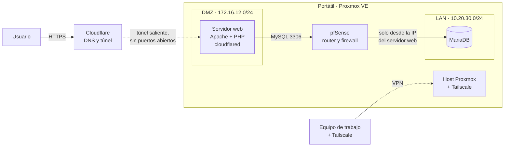

# MetroASIR: aplicación web sobre infraestructura segmentada

Aplicación web accesible sobre el Metro de Madrid, con cálculo de rutas óptimas y
filtro para personas con movilidad reducida, desplegada sobre una infraestructura
virtualizada y segmentada en tres zonas de red.

!!! info "Contexto"
    Trabajo de fin de ciclo del CFGS de Administración de Sistemas Informáticos en
    Red (IES Leonardo Da Vinci, curso 2024/2025), desarrollado junto a Álvaro García
    Ginarte y calificado con un 9,15. Unas 150 horas por persona, organizadas en
    Trello con reuniones semanales. La infraestructura era un entorno de laboratorio
    y ya no está en marcha.

---

## Qué resuelve

La información del Metro de Madrid está repartida entre la app oficial, Google Maps,
Moovit o Citymapper, y ninguna permite calcular una ruta que pase solo por
estaciones adaptadas. MetroASIR reúne mapas, horarios, tarifas y cálculo de
trayectos en una sola web, con la accesibilidad como eje:

- **Rutas óptimas** entre dos estaciones con el algoritmo de Dijkstra, a partir de
  los tiempos de trayecto guardados en la base de datos.
- **Filtro de accesibilidad**: al activarlo, los desplegables de origen y destino
  muestran solo estaciones adaptadas, y el cálculo descarta las que no lo son.
- **Mensajes claros** cuando no existe una ruta accesible, indicando si falla el
  origen, el destino o ambos.

La versión inicial trabaja con los datos de la línea 4.

---

## Arquitectura

| Zona | Rango | Función |
|---|---|---|
| WAN | 192.168.1.0/24 | Red de casa, salida a internet y administración |
| DMZ (OPT1) | 172.16.12.0/24 | Servidor web público: Apache, PHP y túnel de Cloudflare |
| LAN (GREEN) | 10.20.30.0/24 | Servidor de base de datos, sin exposición al exterior |

Todo corre sobre Proxmox VE 8.4 en un portátil con un i5 de 12.ª generación y
16 GB de RAM: una máquina virtual con pfSense y dos con Debian 12.

---

## Decisiones de diseño

**Segmentación en tres zonas.** pfSense separa la red de casa (WAN), la zona
pública (DMZ) y la interna (LAN). El servidor web es lo único que se publica, y la
base de datos solo acepta conexiones al puerto 3306 desde la IP del servidor web,
con una regla de firewall específica.

**Base de datos mínima.** Debian 12 en modo consola, sin entorno gráfico, para
reducir consumo y superficie de ataque. La aplicación usa un usuario propio con
permisos limitados en lugar del administrador.

**Publicación con Cloudflare Tunnel.** El dominio se delegó a los DNS de Cloudflare
y `cloudflared` corre como servicio en el servidor web. El túnel sale desde dentro
hacia Cloudflare, así que el sitio se publica con HTTPS sin abrir puertos en el
router ni gestionar certificados. Además, funciona aunque la conexión esté detrás
de CG-NAT.

**Acceso remoto con Tailscale.** VPN mesh sobre WireGuard instalada en el host de
Proxmox. Permitió que los dos trabajáramos sobre la misma infraestructura desde
casa, de nuevo sin abrir ningún puerto.

**Copias de seguridad.** Copias diarias programadas desde Proxmox de las tres
máquinas, en modo snapshot para no pararlas y con compresión zstd, a un disco
externo montado de forma permanente por UUID en `/etc/fstab`.

**Arranque ordenado.** Proxmox enciende primero pfSense (sin él no hay red),
después la base de datos y por último el servidor web, que depende de ella.

---

## La aplicación

Modelo cliente-servidor: el frontend en HTML, CSS y JavaScript habla con una API
en PHP mediante `fetch()`, con respuestas JSON y sin recargar la página.

| Fichero | Función |
|---|---|
| `conexion.php` | Conexión con MariaDB en la red LAN |
| `estaciones.php` | Lista de estaciones en JSON; con `?accesibles=si`, solo las adaptadas |
| `dijkstra.php` | Implementación del algoritmo de Dijkstra |
| `ruta_dijkstra.php` | Recibe origen, destino y filtro; construye el grafo y devuelve la ruta y el tiempo total |

Todas las consultas que llevan datos del usuario usan **consultas preparadas**, así
que la API no es vulnerable a inyección SQL.

---

## Con qué nos peleamos

**pfSense con una sola tarjeta de red.** La máquina virtual se crea con una
interfaz, y una segmentación WAN/LAN/DMZ necesita tres. Hubo que crear dos bridges
nuevos en Proxmox (`vmbr1` para la DMZ y `vmbr2` para la LAN) y conectar la máquina
a los tres con adaptadores virtio.

**La WAN bloqueaba redes privadas.** pfSense bloquea por defecto el tráfico de
rangos privados (RFC 1918) en la WAN, pensando en que la WAN sea internet. Aquí la
WAN era la red de casa, también privada, así que las zonas internas no salían hasta
desactivar ese bloqueo.

**Recursos justos.** Con 2 GB de RAM para el firewall, se eligió UFS en lugar de
ZFS al instalar pfSense. La monitorización de Proxmox sirvió para ajustar la
memoria de cada máquina a lo que de verdad necesitaba.

**Dos servicios en el mismo puerto.** Desde la red de casa, la interfaz web de
pfSense y el servidor web competían por el mismo puerto en la WAN. Se resolvió con
redirecciones de puertos distintas para cada uno.

**Un puerto 21 que no existía.** En un escaneo con Nmap desde Kali, el host de
Proxmox mostró el puerto 21 (FTP) abierto. `ss` y `lsof` confirmaron que no había
ningún servicio escuchando, y `nmap -sV` lo dejó en falso positivo, probablemente
por una respuesta ambigua del túnel VPN. Aun así se añadió una regla de denegación
explícita, y el puerto pasó a aparecer como filtrado. Lección: verificar antes de
dar un hallazgo por bueno, y cerrar igualmente lo que no tiene por qué responder.

---

## Qué cambiaría hoy

Mirándolo desde mi trabajo actual en seguridad:

- **Credenciales fuera del código.** La versión publicada en el repositorio lleva la
  contraseña de la base de datos escrita en el fichero de conexión y se conecta con
  el usuario administrador. Lo correcto es leerlas de variables de entorno, con un
  `.env` fuera del repositorio, y usar siempre el usuario limitado.
- **Mínimo privilegio de verdad.** El usuario de la aplicación tenía permisos de
  lectura y escritura, pero la aplicación solo consulta datos: bastaba con `SELECT`.
- **MariaDB escuchando solo donde debe.** Durante la configuración se puso
  `bind-address` en `0.0.0.0` de forma temporal. En producción iría fijado a la IP
  de la interfaz LAN.
- **Sin entorno gráfico en la DMZ.** El servidor web tenía XFCE por comodidad. En un
  servidor expuesto, cada paquete de más es superficie de ataque.

---

## Evolución: versión en contenedores

Después del ciclo empezamos a llevar el proyecto a Docker
([MetroASIR-Docker](https://github.com/enriquemontalvomejias/MetroASIR-Docker)),
siguiendo la línea que planteábamos en las conclusiones del TFG:

- **Frontend** en Nginx, que sirve la web estática y hace de proxy inverso hacia el
  backend.
- **Backend** en PHP con Apache, con la misma API.
- **Base de datos** en MariaDB, con volumen persistente y el script SQL cargado
  automáticamente al crear el contenedor.
- Los tres servicios en una red bridge propia, y solo el frontend publica un puerto.

Lo que antes eran tres máquinas virtuales se levanta con un
`docker compose up`. Está en curso, y el siguiente paso natural sería orquestarlo
con Kubernetes.

---

## Código

- [MetroASIR](https://github.com/enriquemontalvomejias/MetroASIR): versión original
  del TFG (API, base de datos y frontend).
- [MetroASIR-Docker](https://github.com/enriquemontalvomejias/MetroASIR-Docker):
  versión en contenedores.
