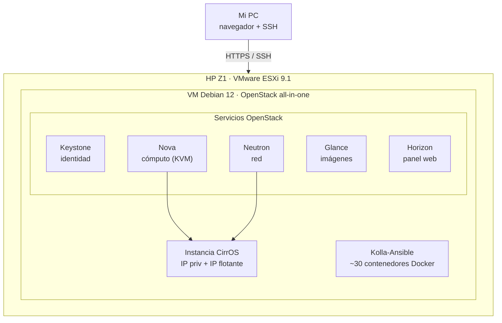

---
proyecto:
  resumen: >-
    Nube privada IaaS en un solo nodo: ~30 servicios en contenedores con
    Kolla-Ansible sobre una VM anidada en ESXi, y una instancia con su IP
    privada y su IP flotante.
  icono: material/cloud-cog-outline
  contexto: Lab personal
  estado: En curso
  fechas: oct 2026
  categorias: [Cloud, Infraestructura]
  stack: [OpenStack, Kolla-Ansible, Ansible, Docker, Debian 12, VMware ESXi, KVM, Neutron, Keystone, Nova, Glance, Horizon]
---

# Cloud privado IaaS con OpenStack

Despliegue de un IaaS privado completo con OpenStack sobre una máquina virtual anidada, usando Kolla-Ansible: identidad, cómputo, red, imágenes y panel web, con una instancia corriendo y el modelo de IP flotante reproducido de principio a fin.

!!! note "Contexto"
    Laboratorio propio montado en una tarde para el portfolio. La idea venía de lejos: en el CFGS de ASIR, un profesor desplegó un OpenStack que usábamos como cloud privado, y se me quedó la espina de montarlo yo. Corre sobre el mismo HP Z1 (i7-9700, 32 GB) que uso para el resto de labs, con ESXi por debajo. Es un entorno de aprendizaje, no un servicio en producción.

* * *

## Qué resuelve

OpenStack es el software con el que se montan nubes privadas tipo IaaS: pides una VM, una red o un disco por autoservicio y la plataforma los crea sola, con proyectos, usuarios y cuotas separados. Es, a grandes rasgos, lo que hay por debajo de un proveedor como Jotelulu o AWS.

El objetivo no era solo "instalarlo", sino **entender cada pieza**:

- **Desplegar el stack completo** (identidad, cómputo, red, imágenes, orquestación y panel) en un solo nodo.
- **Reproducir el modelo de un proveedor cloud**: lanzar una instancia, darle una IP privada y una IP flotante, y entender el NAT entre ambas.
- **Ver dónde está el límite del lab** frente a un proveedor real (IPs públicas, HA, seguridad), que es tan importante como hacerlo funcionar.

* * *

## Arquitectura

Todo el OpenStack corre dentro de una única VM Debian 12, anidada en el ESXi del HP Z1. La virtualización anidada es lo que permite que las instancias de la nube usen KVM real en lugar de emulación.

| Interfaz / red        | Valor              | Función                                                      |
|-----------------------|--------------------|--------------------------------------------------------------|
| Gestión (`ens192`)    | 192.168.1.190      | APIs, acceso a Horizon y salida a internet de la VM          |
| Externa (`ens224`)    | sin IP             | Red externa de Neutron: aquí viven las IPs flotantes         |
| VIP interna           | 192.168.1.250      | IP virtual del balanceador (HAProxy + keepalived), = Horizon |
| Red interna de la VM  | 10.0.0.0/24        | `demo-net`: IP privada de las instancias                     |
| Red flotante          | 10.0.2.0/24        | `public1`: IP flotante (la "pública" dentro del lab)         |

La VM se dimensionó con 6 vCPU, 24 GB de RAM y 120 GB de disco. En reposo, OpenStack consume unos 13 GB de RAM solo en mantener sus contenedores vivos.

* * *

## Decisiones de diseño

**Kolla-Ansible, no Sunbeam ni DevStack.** De las tres vías para montar OpenStack, elegí Kolla-Ansible: despliega cada servicio en un contenedor Docker usando Ansible, soporta Debian 12 de forma oficial y, al configurar la red y los servicios a mano, se entiende mucho mejor qué hace cada pieza. Sunbeam (de Canonical) era la vía rápida pero es un snap atado a Ubuntu; DevStack está pensado para desarrollar OpenStack, no para tener un entorno estable.

**Anidado sobre ESXi, no sobre el metal.** Como ya administro VMware en el trabajo y el HP Z1 tenía ESXi, monté OpenStack en una VM anidada en lugar de dedicar la máquina. Reproduce un escenario realista (empresas migrando desde VMware) y me deja el host para otros labs. El coste es activar la virtualización anidada y tener cuidado con la red.

**Las dos interfaces de red.** OpenStack necesita dos: una de gestión con IP, y una "externa" **sin IP**, que es la que Neutron usa para las IPs flotantes. Olvidar que la segunda va sin dirección es el error clásico.

**El port group de la red externa, en modo promiscuo.** En el vSwitch de ESXi, la red externa necesita modo promiscuo, cambios de MAC y transmisiones falsificadas en "Aceptar". Es justo lo contrario de lo seguro en producción, pero obligatorio en el lab: las instancias usan MACs que el vSwitch no conoce, y sin esto descarta su tráfico y las IPs flotantes no funcionan aunque todo parezca bien.

**Entorno virtual de Python para Kolla.** Instalé Ansible y Kolla-Ansible en un `venv`, no en el Python del sistema, para no pisar los paquetes de Debian. A cambio, algunas dependencias que el bootstrap instala a nivel de sistema hubo que añadirlas al venv a mano.

* * *

## Con qué me peleé

**Dependencias que faltaban en el venv.** Los `prechecks` fueron destapando una a una librerías que no estaban en el entorno virtual: primero el SDK de Docker para Python (`pip install docker`), después `dbus-python`, que no instala solo con pip porque necesita librerías de compilación del sistema (`libdbus-1-dev`, `libglib2.0-dev`, `pkg-config`). Relanzar los prechecks tras cada arreglo es el flujo correcto: no pasar al deploy hasta tener `failed=0`.

**sudo no estaba instalado.** Al poner contraseña de root durante la instalación de Debian, sudo no se instala y el usuario no queda en el grupo. Hubo que instalarlo y añadir el usuario (`usermod -aG sudo`) antes de que Kolla pudiera trabajar.

**El `-i ./all-in-one` en todos los comandos.** El `post-deploy` falló por buscar el inventario en una ruta por defecto que no existe. Kolla necesita que le pases el inventario con `-i` en cada comando, no solo en el deploy.

**La VM no sale a internet, y es correcto.** La instancia arranca y tiene su IP interna, pero no tiene salida a internet. No es un fallo: la red externa (`public1`) vive en un port group aislado del ESXi, sin un router real hacia mi LAN. Para que saliera habría que enrutar esa red hacia casa, que para el lab ni hace falta ni conviene.

* * *

## Qué cambiaría hoy

- **La IP de gestión, fija.** `ens192` coge IP por DHCP (acabó en .190). Si el router se la cambia, rompe el despliegue, porque la VIP y las APIs dependen de ella. En un montaje serio iría con IP estática desde el principio.
- **Trabajar con usuario, no como root.** Monté buena parte como root por rapidez. Lo correcto es el usuario normal con sudo; el `venv` quedó en `/opt` para que cualquier usuario lo active.
- **Salida a internet de las instancias.** El siguiente paso natural es enrutar la red externa para que las VMs salgan de verdad, que es donde se aprende el networking de Neutron en serio.
- **Multi-tenant.** Separar dos proyectos como si fueran dos clientes (usuario, cuota, red y router propios) y demostrar el aislamiento entre ellos. Es lo que convierte "monté OpenStack" en "monté un proveedor cloud en pequeño".

!!! warning "Dónde está el límite"
    La IP flotante del lab (10.0.2.x) se comporta como una pública, pero no lo es: es una dirección privada y aislada. En un proveedor real, esa flotante saldría de un bloque de IPs públicas enrutables, con el mismo mecanismo de NAT que aquí. La diferencia con un Jotelulu no es el software, es el bloque de IPs públicas, la alta disponibilidad, la seguridad endurecida y la operación 24/7. El lab reproduce el **mecanismo**, no el servicio.

