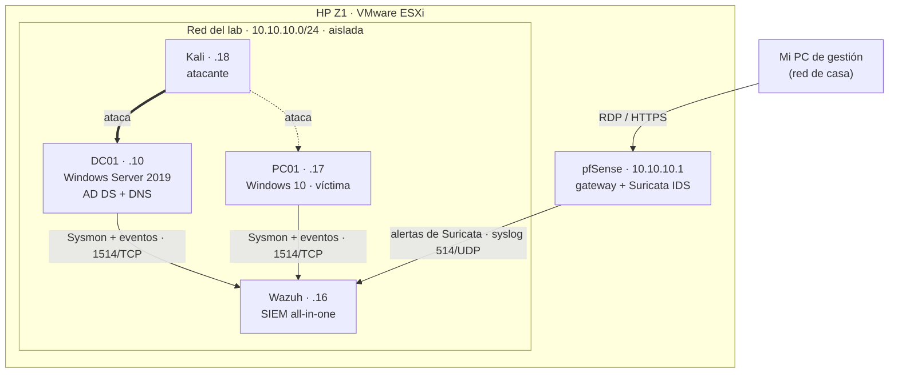

---
proyecto:
  resumen: >-
    Lab de ataque y detección sobre un dominio Active Directory aislado: desde
    Kali lanzo las técnicas y Wazuh las caza correlacionando Sysmon en los
    endpoints con las alertas de red de un Suricata en pfSense. Con decoder y
    reglas propios.
  icono: material/radar
  contexto: Lab personal
  estado: En curso
  fechas: oct–nov 2026
  categorias: [Seguridad, Infraestructura]
  stack: [Wazuh, Suricata, pfSense, Sysmon, Active Directory, Kali Linux, VMware ESXi, Windows Server 2019, nmap]
---

# Lab de purple team con Wazuh

Un dominio de Active Directory montado para dos cosas a la vez: atacarlo y
detectarlo. Desde una Kali lanzo técnicas contra el controlador de dominio, y
enfrente un Wazuh recoge la telemetría de los Windows con Sysmon y las alertas
de red de un Suricata montado en pfSense. El hilo de cada ejercicio es siempre
el mismo: ejecuto la técnica, miro qué deja —o qué no deja— en el SIEM, y ajusto
o escribo la regla que la caza.

!!! note "Contexto"
    Laboratorio propio, en marcha desde octubre de 2026, sobre el mismo HP Z1
    (i7-9700, 32 GB) con VMware ESXi que uso para el resto de labs. Todo
    on-premise y en una red aislada: es un entorno de práctica para el lado de
    detección (SOC) y para el máster de ciberseguridad, no un servicio real. Es
    el hermano pequeño y de laboratorio del Wazuh distribuido que opero en el
    trabajo.

---

## Qué resuelve

Aquí junto los dos lados que en el trabajo veo por separado: el ataque (la
cadena contra Active Directory) y la defensa (la detección y el SIEM). Eso es el
*purple team*.

El objetivo no es "atacar un AD" ni "montar un Wazuh", sino **cerrar el
círculo**: ver qué técnicas dejan rastro, dónde están los puntos ciegos y
escribir la detección que los tapa. Para mi objetivo —seguridad operativa, SOC—
es la pieza que convierte "sé usar Wazuh" en "he detectado ataques reales y he
escrito las reglas que los cazan".

---

## Arquitectura

Todo corre en el ESXi del HP Z1. La clave del diseño es que la red del lab está
**aislada**, para poder detonar técnicas de verdad sin que nada toque mi red de
casa.



| Host | IP | Rol | Qué aporta al SIEM |
|---|---|---|---|
| pfSense | 10.10.10.1 | Firewall/gateway + Suricata (IDS) | Alertas de red por syslog |
| DC01 | 10.10.10.10 | Windows Server 2019 · AD DS + DNS (`kiceland.lab`) | Sysmon + eventos de Windows |
| PC01 | 10.10.10.17 | Windows 10 · cliente víctima, unido al dominio | Sysmon + eventos de Windows |
| Wazuh | 10.10.10.16 | Ubuntu 24.04 · SIEM all-in-one (4.14) | — (es el SIEM) |
| Kali | 10.10.10.18 | Atacante | — |

La red del lab cuelga de un vSwitch **sin salida física**: el único puente al
exterior es pfSense, y una regla de firewall impide que el lab alcance mi red de
casa. Comprobado: desde el lab llego al dominio y a internet, pero no a casa.

---

## Decisiones de diseño

**All-in-one, no distribuido.** Para un host y un puñado de VMs, un solo Wazuh
(manager, indexer y dashboard en la misma máquina) sobra. El modelo distribuido
en dos nodos tiene sentido en producción —separar el indexer, que es el que más
RAM y disco consume— y así es como lo opero en el trabajo; en el lab solo me
comería la RAM que necesito para el resto de VMs.

**Red aislada detrás de pfSense.** La LAN no tiene uplink físico y el único
camino al exterior pasa por el firewall. Es lo que me deja lanzar ataques reales
sin riesgo para la red de casa.

**Telemetría en dos capas.** Endpoint y red. En los Windows, Sysmon (con la
configuración de SwiftOnSecurity) más el agente de Wazuh; en la red, Suricata en
pfSense. No es redundancia: cada capa ve cosas distintas, y buena parte del
aprendizaje es descubrir dónde ve una y la otra es ciega.

**Suricata en modo IDS.** Solo alerta, no bloquea. En un lab quiero ver pasar
todo el tráfico que estoy estudiando, no cortarlo.

**Windows en español.** Un detalle que importa al escribir detección: el grupo
de administradores es `Admins. del dominio`, no "Domain Admins", y algún nombre
de campo cambia. Mejor saberlo antes de escribir una regla que no casa por el
idioma.

---

## Enseñar a Wazuh a leer Suricata

La integración que más tela tuvo fue meter las alertas de Suricata dentro de
Wazuh. pfSense las manda por syslog (facility `LOCAL1`) y Wazuh las escucha en un
segundo bloque `<remote>`, aparte del de los agentes:

```xml
<remote>
  <connection>syslog</connection>
  <port>514</port>
  <protocol>udp</protocol>
  <allowed-ips>10.10.10.1</allowed-ips>
</remote>
```

El problema es que lo que sale por syslog es el formato *fast* de Suricata —una
línea de texto plano— y Wazuh no la entiende de serie. Encima, pfSense la manda
**sin hostname**, así que el pre-decoder de Wazuh se come el `suricata[pid]:`
como si fuera el nombre de la máquina y nunca llega a identificar el programa. Un
decoder basado en `program_name` no casa jamás.

La solución fue un decoder que reconoce la alerta **por su contenido**, no por el
nombre del programa, y que extrae los campos que me interesan:

```xml
<decoder name="suricata-fast">
  <prematch type="pcre2">\[\d+:\d+:\d+\] .+ \[Priority: \d+\] \{\w+\}</prematch>
</decoder>

<decoder name="suricata-fast-alert">
  <parent>suricata-fast</parent>
  <regex type="pcre2">\[(\d+:\d+:\d+)\] (.+?) (?:\[Classification: ([^\]]+)\] )?\[Priority: (\d+)\] \{(\w+)\} ([\d.]+):?(\d*) -> ([\d.]+):?(\d*)</regex>
  <order>sid, signature, classification, priority, protocol, srcip, srcport, dstip, dstport</order>
</decoder>
```

Y una regla que mapea la **prioridad de Suricata al nivel de Wazuh**, para que el
IDS no entierre lo importante entre ruido:

```xml
<group name="suricata,ids,pfsense,">

  <rule id="100200" level="3">
    <decoded_as>suricata-fast</decoded_as>
    <field name="sid">\.+</field>
    <description>Suricata: $(signature)</description>
  </rule>

  <rule id="100201" level="7">
    <if_sid>100200</if_sid>
    <field name="priority">^2$</field>
    <description>Suricata (prioridad 2): $(signature)</description>
  </rule>

  <rule id="100202" level="10">
    <if_sid>100200</if_sid>
    <field name="priority">^1$</field>
    <description>Suricata (prioridad 1): $(signature)</description>
  </rule>

</group>
```

Validé cada paso con `wazuh-logtest`, que enseña las tres fases —pre-decoding,
decoding y reglas— de una línea de log. Pasé de un `No decoder matched` a la
alerta decodificada con su IP de origen, su firma y su prioridad, y apareciendo
en el panel.

---

## El primer caso: reconocimiento

El ejercicio con el que estrené la cadena fue el más básico, un `nmap` desde Kali
contra el controlador de dominio, y sirve justo para ver el valor de tener las
dos capas:

- **El endpoint es ciego al escaneo.** Un `nmap -sS` no genera nada en el DC:
  escanear puertos no es visibilidad de endpoint. Solo cuando nmap abre sesiones
  de verdad (los scripts SMB de `-sC`) aparecen inicios de sesión (evento 4624)
  en el DC.
- **La red sí lo ve.** Suricata detecta el escaneo… pero al principio solo
  saltaban anomalías de protocolo genéricas, ninguna firma específica de
  escaneo.
- **Afinar hasta la firma correcta.** Faltaban dos cosas: cargar la categoría de
  reglas de escaneo (`emerging-scan`) en la interfaz, y sacar a Kali del HOME_NET
  de Suricata, porque las firmas de escaneo miran el tráfico "de fuera hacia lo
  mío" y Kali estaba contado como "de dentro". Con las dos, salta la firma **ET
  SCAN NMAP OS Detection Probe** y mi regla la sube a nivel 7 en Wazuh.

!!! note "La lección del punto ciego"
    Las firmas de red de perímetro no ven el reconocimiento que viene de dentro.
    Si quien escanea es un equipo ya comprometido de la propia red —el escenario
    realista—, ese tráfico es "de dentro hacia dentro" y la mayoría de firmas de
    escaneo no saltan. Ahí es donde la telemetría de endpoint y las reglas
    internas hacen el trabajo que el IDS no puede. Es justo lo que quiero
    demostrar en las siguientes fases.

---

## Con qué me peleé

**El syslog de pfSense deja de enviar al reiniciar Wazuh.** El syslogd de pfSense
manda por UDP y, si el destino no responde ni un instante (mientras el manager se
reinicia), descarta ese destino y deja de enviarle, sin reintentar. El proceso
sigue vivo pero pfSense queda mudo. Me costó un rato entenderlo: ahora, cada vez
que reinicio el manager, reinicio después el syslogd.

**Las reglas en la carpeta equivocada.** Puse las reglas en `decoders/` en vez de
`rules/`. Wazuh carga como decoder todo lo que hay en esa carpeta, se encuentra
un `<rule>`, no lo entiende y el manager no arranca. El `journalctl` lo cantaba:
error de configuración en `etc/decoders`.

**El decoder que no casaba.** pfSense manda el syslog sin hostname y el
pre-decoder se come el nombre del programa. La pista estaba en la fase 1 del
`wazuh-logtest`, que mostraba `hostname: 'suricata[pid]:'`. La solución fue el
`prematch` por contenido.

**tcpdump no es prueba de nada.** Durante el diagnóstico vi los paquetes llegar
con `tcpdump` y di por hecho que Wazuh los procesaba. Falso: tcpdump captura
**antes** que el socket de la aplicación. La prueba buena es de punta a punta:
inyectar un mensaje en el origen (`logger`) y verlo aparecer en el log del
destino.

---

## Lo que viene

La cadena está montada y el reconocimiento, cerrado. A partir de aquí el plan es
recorrer las fases de un ataque a Active Directory, cada una con su detección:

| Fase | Técnica | Qué debería cazarla |
|---|---|---|
| Enumeración | Usuarios, política de contraseñas y bloqueo | Volumen de consultas y accesos |
| Password spraying | Una contraseña contra muchas cuentas | 4625/4624 → mi **primera regla de correlación** |
| Kerberoasting / AS-REP | Pedir tickets para crackearlos offline | Eventos 4769 / 4768 |
| Movimiento lateral | Saltar de un equipo a otro (WinRM, WMI) | Logon tipo 3 + procesos en Sysmon |
| Volcado de credenciales | DCSync: replicar como si fueras un DC | Evento 4662 con el GUID de replicación |

Más adelante, dos líneas que me interesan: una **regla de correlación** que
agrupe la ráfaga de alertas de un mismo escaneo en una sola de nivel alto, y
llevar el conjunto hacia **SOAR** (Shuffle + TheHive) para pasar de "detecto" a
"gestiono el caso", que es el flujo real de un SOC.
