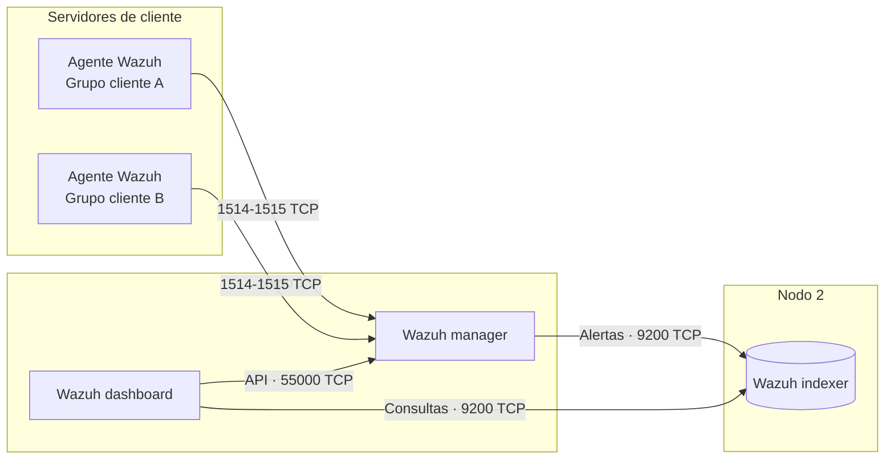

# SIEM distribuido con Wazuh

Despliegue de Wazuh como SIEM/XDR en arquitectura distribuida de dos nodos, en
cloud, para monitorizar servidores de cliente.

!!! note "En curso"
    La plataforma está desplegada y recibiendo eventos de los agentes. La parte
    de análisis (interpretar alertas, ajustar reglas y reducir ruido) es lo que
    estoy trabajando ahora, y se documentará aquí a medida que avance.

---

## Arquitectura

**Por qué dos nodos.** El indexer es el componente que más memoria y disco
consume, porque almacena e indexa todas las alertas. Separarlo del manager
permite dimensionar cada máquina según su carga, y evita que una consulta pesada
desde el dashboard compita por recursos con la recepción de eventos de los
agentes. Manager y dashboard comparten máquina.

**Despliegue.** Los dos nodos están en cloud y se montaron siguiendo la guía
oficial de instalación distribuida: generación de certificados para cifrar la
comunicación entre componentes, instalación e inicialización del indexer, y
después el manager y el dashboard apuntando a él.

**Agentes.** Despliegue y actualización de agentes en servidores de cliente,
organizados en grupos. Los grupos permiten aplicar configuración distinta por
cliente o por tipo de servidor, como qué logs recoger o qué módulos activar,
sin tocar cada agente uno a uno.

---

## Lo que viene

- Lectura e interpretación de alertas: niveles, reglas y decoders.
- Ajuste de reglas para reducir falsos positivos.
- Casos concretos analizados de principio a fin.
